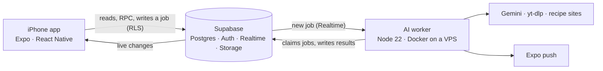

# Mesa

**Your kitchen, understood.** Mesa is an iPhone app that takes the mental load out of home cooking. It
keeps track of what a household has at home and of the recipes it saves. From that it suggests what to
cook and fills the shopping list. Recipes can come from anywhere: a TikTok, a YouTube Short, a website, a
screenshot.

It is in daily use by its first household through TestFlight. The app is built with Expo and React
Native, the backend runs on Supabase, and a TypeScript worker on a VPS does the AI work.

## What it does

- **Import any recipe.** Share an Instagram, TikTok or YouTube video, a website or a few screenshots. Mesa
  watches or reads it and writes the recipe down: ingredients, steps, and the timestamps in the video.
- **Shopping list.** It is as fast to type into as Notes ("6 eggs, 1 L milk"), is sorted by aisle, and
  stays in sync between phones within a second. When the shopping is done, the items go into the pantry.
- **Pantry.** It is organized by food family. You fill it by filming a shelf or scanning a receipt; Mesa
  proposes what it saw, and you confirm.
- **What to cook.**
  - Tonight's idea uses what has to go first.
  - Up next adds the missing ingredients to the list.
  - "Cooked!" takes what was used out of the pantry.
- **Ask Mesa.** One assistant for the whole kitchen:
  - questions about a recipe or what's at home;
  - substitutions;
  - "plan my week";
  - real recipe videos found for you.

  Answers stream in as they are written.
- **Discovery.** Five recipe videos picked each week from what you actually cook, each with the reason
  it was picked. You can also follow your favourite creators.

Mesa's principles: it never invents a recipe and always cites its source. It proposes, and you decide.
And it works in any country, in any language.

## Architecture



The app never talks to an AI provider or a third-party site. It writes the input of a job, and row-level
security lets it write nothing more. The worker claims the job, does the work and writes the result. The
phones see the result arrive through Realtime.

## Engineering highlights

- **A reliable job queue in Postgres.** Workers claim jobs with `for update skip locked`, in two lanes, so
  quick questions never wait behind a long video import. Realtime wakes idle workers at once, with polling
  as the fallback. If a worker crashes, its jobs go back to the queue, for 3 attempts at most. When a worker
  stops, the jobs in progress get time to finish.
- **AI with guardrails.** Gemini sits behind a model interface, and each kind of job gets only what it
  uses. If a model is busy, the worker moves on to the next one in a chain. A daily budget caps tokens and
  calls, and each household has a quota. Every answer must follow a JSON schema, written once for any
  model. Ask Mesa's text is parsed while it is still being written, so it can stream to the phone.
- **Secure for many households.**
  - Row-level security scopes every table to its household.
  - Photos and receipts sit in private storage and are deleted after use.
  - Invite codes have a limited number of attempts.
  - Fetching a shared link cannot reach the server's own network: every resolved address and every
    redirect is checked (SSRF).
- **Works offline.** TanStack Query keeps a persisted cache, so the list and the recipes show at once,
  even with no network. Changes appear before the server confirms them. Changes made offline wait, and
  are sent when the connection returns (as long as the app stays open).
- **A design system enforced by tooling.** It is built from tokens, atoms, molecules and organisms. A
  check script fails if a screen uses raw styles, literal colors or numbers, or imports anything outside
  the design system and data layers.
- **Tested at every layer.**
  - Over 900 unit tests (Vitest) cover the worker and the shared package.
  - 23 SQL test suites replay every migration on a disposable Postgres.
  - One suite checks that every join the API serves has exactly one foreign key.
- **Shipping.**
  - iOS builds go to TestFlight through EAS.
  - Over-the-air updates are keyed to a native fingerprint, so JS-only fixes ship without a new build.
  - The worker deploys with one script.
  - The database is backed up every night.
- **International from the start.** The shared catalog has 177 products and 1,588 aliases in English,
  Spanish and French. The parser reads grocery lines and recipe lines typed freely.

## Tech stack

| Layer | Tools |
| --- | --- |
| Mobile | Expo SDK 58, React Native 0.88, Expo Router (typed routes), TanStack Query, Reanimated, iOS share extension |
| Backend | Supabase: Postgres (row-level security, SQL functions), Auth (email, Sign in with Apple), Realtime, Storage |
| Worker | Node 22, TypeScript, Gemini, yt-dlp, schema.org parsing, Docker Compose |
| Shared | TypeScript package: free-text parsing, units and quantities, aisles, product catalog |
| Tooling | pnpm workspaces, TypeScript strict, Vitest, SQL tests on Postgres, EAS Build / Update / Submit |

## Repository layout

| Path | What it holds |
| --- | --- |
| `apps/mobile` | The iPhone app: screens in `app/`, design system in `src/ds`, data layer in `src/data` |
| `apps/worker` | The AI worker: imports, Ask Mesa, ideas, week plans, discovery |
| `packages/shared` | Code shared by the app and the worker |
| `supabase/migrations` | Schema, row-level security, SQL functions, catalog (30 migrations) |
| `db-tests` | SQL tests run against every migration |
| `infra/vps` | Docker Compose for the worker and the nightly backup, plus the deploy script |
| `docs` | Product vision, roadmap, API contract, design system, release notes |

## Running it locally

You need Node 22, pnpm and Docker (for the SQL tests).

```bash
pnpm install
pnpm typecheck                        # the whole monorepo
pnpm test                             # unit tests (shared + worker)
pnpm test:db                          # migrations + SQL tests on a disposable Postgres
pnpm --filter @mesa/mobile check:ds   # design system rules

cp apps/mobile/.env.example apps/mobile/.env   # Supabase URL + anon key
pnpm mobile                                    # Expo dev server
```

More detail on running the app and on its development build is in `apps/mobile/README.md`. Setting up
the worker on a server is in `infra/vps/README.md`.

## Documentation

| File | Contents |
| --- | --- |
| `docs/PRODUCT_VISION.md` | The product vision and promise |
| `docs/ROADMAP.md` | What's done, what's next, the product principles (in French) |
| `docs/CONTRACT.md` | Database schema, SQL functions, the API the app and worker share |
| `docs/DESIGN_SYSTEM.md` | Tokens, components and interface rules |
| `docs/DEPLOY.md` | Day-to-day deployment runbook (in French) |
| `docs/RELEASE.md` | TestFlight and monitoring checklist (in French) |
